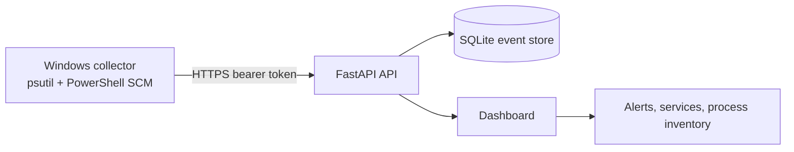

# Sentinel Windows Monitor

A deployable blue-team monitoring project for Windows process behavior and service configuration. It pairs a least-privilege Windows collector with a small FastAPI ingestion API and web dashboard. The cloud service stores monitoring events; it does not attempt to control the endpoint.

## What it detects

- High-risk parent/child pairs (for example Office applications starting shells or script hosts).
- Processes executing from temporary or user-writable locations, unknown executable names, and configured deny-list entries.
- Automatic services with suspicious executable paths, newly observed services, and service configuration changes.
- Optional baseline comparison across snapshots. Detection is heuristic and produces leads for review, not proof of compromise.

## Architecture



The collector can run locally in report-only mode, or send snapshots to a hosted API. Do not expose the API without setting a long random `API_TOKEN`; use HTTPS on the public host. For a real fleet, replace SQLite with PostgreSQL and add per-device identity and retention controls.

## Quick start (local)

Requirements: Python 3.11+, Windows 10/11 or Windows Server. From PowerShell:

```powershell
py -3.11 -m venv .venv
.\.venv\Scripts\Activate.ps1
pip install -r requirements.txt
Copy-Item .env.example .env
# Set API_TOKEN in .env to a long random secret before exposing the API.
uvicorn app.main:app --reload
```

Open http://127.0.0.1:8000. In a second PowerShell window:

```powershell
pip install -r agent/requirements.txt
$env:MONITOR_API_URL = 'http://127.0.0.1:8000'
$env:MONITOR_API_TOKEN = 'replace-with-the-same-token'
py agent/collector.py --once
```

Run the collector periodically using Task Scheduler (see `docs/DEPLOYMENT.md`). Administrator rights improve service configuration visibility but are not required for basic process inventory. Review the script before running it with elevated privileges.

## Deploy the dashboard/API

This repository includes a Render Blueprint (`render.yaml`). Push the repository to GitHub, create a Render Web Service from that repository, and set a strong `API_TOKEN` in the service environment. The blueprint uses a persistent disk for SQLite. After deploy, open the service URL; configure the Windows collector with that URL and the same token. Step-by-step instructions, environment variables, and GitHub publishing steps are in [`docs/DEPLOYMENT.md`](docs/DEPLOYMENT.md).

## API

- `GET /api/health` health and version.
- `GET /api/summary` counts and recent activity (dashboard endpoint).
- `GET /api/alerts?limit=100` alert records.
- `POST /api/snapshots` authenticated collector ingestion.
- `GET /api/snapshots/latest` latest snapshot per endpoint.

All collector routes require `Authorization: Bearer <API_TOKEN>` when a token is configured. The dashboard is read-only and does not expose the token.

## Configuration

See `.env.example` and `config/rules.json`. Add or remove process names and parent/child rules to match your environment. Keep rules explicit and document exceptions. The first observed service state becomes the baseline; subsequent new or changed automatic services are reported.

## Repository map

```text
app/                 FastAPI API, SQLite store, static dashboard
agent/               Windows snapshot collector and rules
config/rules.json    Detection rules
docs/                Deployment guide and detection notes
render.yaml          Render deployment blueprint
```

## Security and limitations

This is a defensive educational starter, not an EDR replacement. Process signatures are not cryptographically verified by the starter collector; names and paths can be spoofed. Service ACL escalation checks and memory injection detection require deeper Windows-specific controls and are intentionally not claimed here. Restrict access, use HTTPS, rotate credentials, and validate alerts with endpoint telemetry. Never commit `.env`, tokens, or collected sensitive process command lines.

## License

MIT. See [`LICENSE`](LICENSE).
